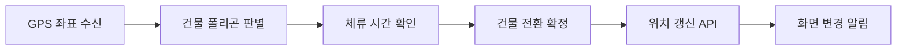

<div align="center">

  

  <h1>빌릿 · Villit</h1>

  <p><strong>캠퍼스 안에서, 필요한 물건을 가까운 사람에게.</strong></p>
  <p>위치 기반 교내 물품 대여 매칭 서비스의 Flutter 프론트엔드</p>

  
  
  
  

  <br><br>

  <a href="https://github.com/com0ze/Villit_Frontend/tree/feature/update">프론트엔드 소스</a> ·
  <a href="https://github.com/com0ze/Villit_Backend/tree/develop">백엔드 저장소</a>

</div>

<br>

[프로젝트 소개](#프로젝트-소개) · [주요 기능](#주요-기능) · [핵심 구현](#핵심-구현) · [기술 스택](#기술-스택) · [실행 방법](#실행-방법) · [프로젝트 구조](#프로젝트-구조)

## 프로젝트 소개

**Villit**은 동국대학교 캠퍼스에서 급하게 물품이 필요한 학생과 가까운 공급자를 연결하는 대여 매칭 서비스입니다. 요청 등록부터 상대방과의 채팅, 물품 전달·반납, 후기 작성까지 하나의 앱에서 이어집니다.

프론트엔드는 **건물 단위 위치 인식**, **대여 상태에 따른 화면 구성**, **JWT 기반 인증**, **실시간 채팅과 푸시 알림**을 담당합니다. 가까운 후보를 탐색하는 BFS 기반 매칭 로직은 백엔드에서 처리합니다.

| 항목 | 내용 |
| :--- | :--- |
| 개발 기간 | 2026.03 – 2026.06 |
| 프로젝트 | 동국대학교 공개SW프로젝트 · 4인 팀 프로젝트 |
| 클라이언트 | Flutter 기반 모바일 앱 · Android 중심 |
| 주요 화면 | 요청하기 · 대여 목록 · 채팅 · 마이페이지 |
| 구현 코드 | [`feature/update`](https://github.com/com0ze/Villit_Frontend/tree/feature/update) |

> 현재 `main`에는 기본 문서만 있으며, 이 README는 최종 업데이트 코드가 있는 `feature/update` 브랜치를 기준으로 작성되었습니다.

## 주요 기능

| 기능 | 설명 |
| :--- | :--- |
| **회원가입·로그인** | 학교 이메일 도메인 검사, 이메일·비밀번호 로그인, 저장된 토큰을 이용한 자동 로그인 |
| **건물 단위 위치 인식** | GPS 좌표와 캠퍼스 GeoJSON 폴리곤을 비교해 현재 건물을 판별하고 위치 변경을 서버에 반영 |
| **대여 요청·조회** | 필요한 물품과 요청 내용을 등록하고, 현재 건물과 거래 상태에 맞는 요청 목록 조회 |
| **매칭·거래 진행** | 요청 수락, 채팅방 생성, 물품 전달·거래 완료·취소 처리와 상태별 UI 제공 |
| **실시간 채팅** | WebSocket·STOMP 기반 채팅방 구독, 메시지 송수신 및 기존 대화 조회 |
| **푸시 알림** | FCM 기기 토큰 등록, 요청 알림 수신 및 알림 선택 시 요청 상세 화면 이동 |
| **프로필·후기** | 내 거래 내역, 사용자 프로필, 후기 조회·작성 및 공급 가능 상태 변경 |
| **테마 설정** | 라이트·다크·시스템 테마 선택과 설정 저장 |

### 서비스 이용 흐름


## 핵심 구현

### 1. 건물 경계 기반 위치 갱신

GPS 좌표를 수신할 때마다 서버에 전송하는 대신, **기기에서 현재 건물을 판별하고 건물 전환이 확정될 때 위치를 갱신**하도록 구성했습니다.

- `assets/dongguk_campus.geojson`의 건물별 폴리곤을 읽고, `maps_toolkit`의 점 포함 판별로 현재 건물을 찾습니다.
- 경계 근처에서 GPS가 흔들리는 상황을 고려해 **같은 후보 건물이 5초 이상 유지되는지 확인하는 체류 시간 로직**을 적용했습니다.
- 건물 전환이 확정되면 `PATCH /api/v1/users/location`을 호출하고, 이후 리스너에 변경을 알려 관련 화면이 갱신되도록 구성했습니다.
- 최초 위치 확인과 수동 새로고침은 체류 시간 대기 없이 현재 건물을 확인하고 서버에 반영합니다.



GPS 수신 자체를 중단하는 방식이 아니라, **위치 감지와 서버 전송의 기준을 분리해 불필요한 통신을 줄이려는 구조**입니다.

### 2. 인증 요청과 토큰 갱신 처리

- `flutter_secure_storage`를 이용해 Access Token과 Refresh Token을 저장합니다.
- Dio의 `AuthInterceptor`에서 인증 헤더를 추가하고, `401` 응답이 오면 토큰 갱신 후 기존 요청을 재시도합니다.
- 여러 요청에서 동시에 인증 오류가 발생할 때 진행 중인 갱신 `Future`를 공유하도록 구성했습니다.
- 토큰 갱신이 실패하면 세션을 정리하고 로그인 화면으로 이동하도록 처리합니다.

### 3. 거래 데이터와 화면 상태 연결

- `DataManager`에서 사용자·대여 요청·매칭·채팅·후기 데이터를 관리합니다.
- `ChangeNotifier`와 `ListenableBuilder`로 데이터 변경을 화면에 반영하고, 반복되는 카드 UI는 위젯 팩터리로 분리했습니다.
- `pending`, `matchConfirmed`, `inProgress`, `returned` 등 거래 상태와 참여자에 따라 화면에 표시할 정보와 동작을 구분합니다.

### 4. 채팅과 알림 연동

- STOMP 클라이언트에서 채팅방을 구독하고 메시지를 송수신합니다. 연결 전에 요청한 구독은 연결 완료 후 등록하도록 구성했습니다.
- 로그인 후 FCM 기기 토큰을 서버에 등록하고, 토큰 변경도 서버와 동기화합니다.
- 앱의 실행 상태에 맞춰 메시지를 처리하고, 대여 요청 알림을 선택하면 해당 요청의 상세 화면으로 연결합니다.

## 기술 스택

| 영역 | 기술·라이브러리 | 용도 |
| :--- | :--- | :--- |
| 앱 개발 | **Flutter · Dart** | 모바일 화면 및 애플리케이션 로직 |
| UI | **Material 3 · ChangeNotifier · ListenableBuilder** | 테마 구성 및 상태 변경 반영 |
| HTTP 통신 | **Dio** | REST API 호출, 인증 인터셉터, 오류 처리 |
| 토큰 저장 | **flutter_secure_storage** | 인증 토큰과 설정 저장 |
| 위치 처리 | **geolocator · maps_toolkit · GeoJSON** | GPS 수신 및 건물 폴리곤 판별 |
| 채팅 | **stomp_dart_client · WebSocket** | STOMP 기반 실시간 메시지 통신 |
| 알림 | **firebase_core · firebase_messaging · flutter_local_notifications** | Firebase 초기화, 푸시 및 로컬 알림 |
| 이미지 | **flutter_svg** | SVG 로고 표시 |

## 실행 방법

### 1. 개발 환경 준비

- `pubspec.yaml`의 **Dart SDK `^3.11.4`** 조건을 충족하는 Flutter SDK
- Android SDK, 에뮬레이터 또는 Android 실기기
- Android 빌드 설정과 호환되는 JDK · 프로젝트의 Java/Kotlin 타깃은 **17**
- 실행 가능한 Villit 백엔드와 앱에 연결할 Firebase 프로젝트

```bash
flutter doctor
```

### 2. 구현 브랜치 받기

```bash
git clone --branch feature/update https://github.com/com0ze/Villit_Frontend.git
cd Villit_Frontend
flutter pub get
```

### 3. 백엔드 연결 주소 설정

현재 서버 주소는 아래 파일에 직접 설정되어 있습니다. **일반 API·토큰 갱신·채팅 주소를 모두 같은 실행 환경에 맞게 변경**합니다.

| 파일 | 변경할 항목 |
| :--- | :--- |
| `lib/api/api_client.dart` | `BaseOptions.baseUrl` — 일반 REST API 서버 주소 |
| `lib/api/auth_interceptor.dart` | `_doRefresh()` 내부 `BaseOptions.baseUrl` — 토큰 갱신 서버 주소 |
| `lib/chat/stomp_client.dart` | `_baseUrl` 및 `_wsPath` — WebSocket 주소와 STOMP 엔드포인트 |

예시 형식은 REST API가 `http://<BACKEND_HOST>:8080`, WebSocket이 `ws://<BACKEND_HOST>:8080`입니다. 현재 STOMP 경로는 `/ws-stomp`이며, 실제 백엔드 설정과 일치시켜야 합니다. 기기에서 해당 서버에 접근할 수 있는지도 확인합니다.

### 4. Firebase·기기 권한 설정

- **Android:** 앱 패키지 `com.example.open_source_software`와 연결되는 Firebase 앱을 설정하고, 프로젝트에 맞는 `android/app/google-services.json`을 준비합니다.
- **iOS:** 별도 Firebase 앱 등록과 `GoogleService-Info.plist`, APNs·푸시 알림 및 백그라운드 기능 설정이 필요합니다. 저장소에 iOS 프로젝트가 포함되어 있으나, 설정 파일만으로 동작 검증을 보장하지는 않습니다.
- 앱 실행 후 **위치 서비스와 위치·알림 권한**을 허용합니다. 건물 판별을 확인하려면 캠퍼스 좌표를 사용하고, 백그라운드 동작은 OS의 권한·배터리 정책도 함께 확인합니다.

### 5. 앱 실행

```bash
flutter devices
flutter run -d <DEVICE_ID>
```

Android 디버그 APK를 생성하려면 다음 명령을 사용합니다.

```bash
flutter build apk --debug
```

<details>
<summary><strong>목업 코드와 검증 상태 참고</strong></summary>

현재 `feature/update`는 **실제 REST API와 STOMP 서버 연결을 기본으로 사용**합니다. 저장소에는 `MockServerInterceptor`, `MockStompClient`, `MockNotificationManager`도 포함되어 있지만, 별도의 실행 옵션 하나로 전체 목업 모드가 활성화되는 구성은 아닙니다.

목업으로 시연하려면 API·토큰 갱신·채팅 클라이언트의 연결 구현을 함께 확인해야 합니다. 모바일 앱 시작 시 수행하는 Firebase 초기화도 별도로 고려해야 합니다.

정적 분석과 테스트 명령은 다음과 같습니다.

```bash
flutter analyze
flutter test
```

현재 `test/widget_test.dart`는 Flutter 기본 카운터 예제 테스트이므로, 실제 로그인·대여 화면에 맞는 테스트로 보완해야 합니다. 이 README는 코드와 설정을 바탕으로 정리한 문서이며, 명령 실행 성공이나 전체 시나리오의 검증 완료를 뜻하지 않습니다.

</details>

## 프로젝트 구조

```text
lib/
├── api/          # Dio 클라이언트 · 인증 및 목업 인터셉터
├── chat/         # STOMP 채팅 인터페이스 · 실제/목업 구현
├── extensions/   # 거래 상태 · 테마 관련 확장
├── managers/     # 로그인 · 토큰 · 위치 · 알림 · 데이터 · 테마 관리
├── models/       # 사용자 · 건물 · 대여 요청 · 매칭 · 채팅 · 후기 모델
├── screens/      # 로그인 · 요청 · 목록 · 상세 · 채팅 · 프로필 화면
├── widgets/      # 재사용 카드 · 위젯 팩터리 · 위치 새로고침 버튼
├── app_keys.dart # 전역 내비게이션 · 메시지 표시 키
└── main.dart     # Firebase · 인증 · 알림 초기화와 앱 진입점

assets/
├── dongguk_campus.geojson  # 캠퍼스 건물 경계 데이터
├── villit_logo.svg        # 앱 내 로고
└── villit_logo.png        # 런처 아이콘 생성용 이미지
```

## 관련 저장소 · 라이선스

- [Villit Frontend](https://github.com/com0ze/Villit_Frontend/tree/feature/update)
- [Villit Backend](https://github.com/com0ze/Villit_Backend/tree/develop)
- 본 프로젝트는 [MIT License](LICENSE)를 따릅니다.
